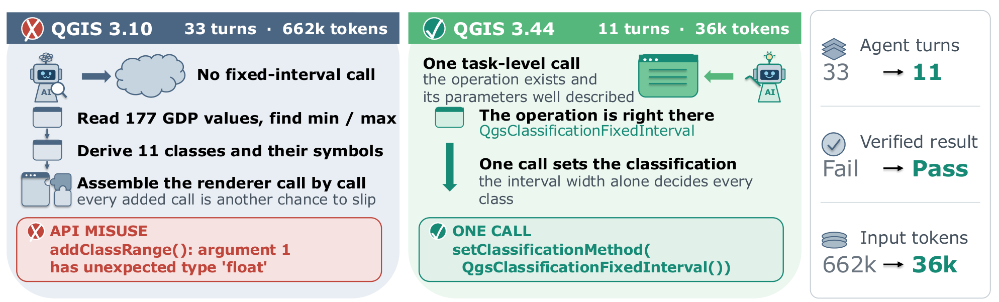

<div align="center">

# ANIS: Agent-Native Interface Synthesizer

### Turn any installed desktop application into a verified command-line interface for LLM agents

<p>
  <a href="https://arxiv.org/abs/2610.15765"></a>
  <a href="https://huggingface.co/datasets/SimAlan/DeskIF-Bench"></a>
  <a href="LICENSE"></a>
  
  
</p>

<p>
  <b>A Decade in a Day: Synthesizing Agent-Native Interfaces from Human-Oriented Software Evolution</b><br>
  Alan Wu, Wei Tao, Yiwen Guo
</p>

<p>
  <a href="https://arxiv.org/abs/2610.15765">📄 Paper</a> ·
  <a href="https://huggingface.co/datasets/SimAlan/DeskIF-Bench">🤗 Benchmark</a> ·
  <a href="#quick-start">🚀 Quick start</a> ·
  <a href="#results">📊 Results</a> ·
  <a href="#citation">📝 Citation</a>
</p>

</div>

---

Desktop applications were designed for people who can see buttons and for
developers who can read SDK docs. LLM agents are neither. Given only a GUI or a
raw SDK, they spend most of their budget on finding the right operation,
composing low-level calls, and guessing whether an edit worked.

Software evolution has already shown what fixes this. When a newer release of an
application adds a clearly described, task-level operation, the same agent on
the same task can go from failing to passing:

<p align="center">
  
</p>

**ANIS gives you that decade of interface improvement in a day.** It reads the
capabilities of an application you have installed and synthesizes an interface
built for agents:

- 🔍 **Discoverable.** Every capability becomes a named, documented command
  such as `layout-legend-add`, with example arguments, instead of an object
  graph the agent has to explore.
- 👀 **Observable.** Paired read-only commands such as `layer-get-opacity`
  let the agent check the artifact state after every edit.
- 🧩 **Right granularity.** Recurring multi-step sequences learned from real
  requests are packaged into verified goal-level commands.
- ✅ **Verified before release.** Every command runs against the live
  application and must save the state it promises. Commands that fail are left
  out of the release.

## Highlights

<table>
<tr>
<td align="center" width="25%"><h3>74.5%</h3>overall success with goal-level commands<br><sub>vs. 68.5% with the native SDK</sub></td>
<td align="center" width="25%"><h3>~73% fewer</h3>tokens per task<br><sub>84.4K → 21.2K</sub></td>
<td align="center" width="25%"><h3>+57.1 pts</h3>over CLI-Anything<br><sub>with 20× more commands</sub></td>
<td align="center" width="25%"><h3>8 apps</h3>office, 2D, 3D, GIS, CAD<br><sub>2 held out until evaluation</sub></td>
</tr>
</table>

<sub>Numbers use DeepSeek V4 Flash on 368 tasks. The ordering is the same with Claude Haiku 4.5.</sub>

## How it works

<p align="center">
  
</p>

| Stage | What happens | Code |
| --- | --- | --- |
| 1. Capability discovery | Find programmatic entry points and take a census of runtime objects, algorithms, properties, and menu items. Generate an application adapter. | `stages/01_capability_discovery/` |
| 2. Semantic filtering | Keep the capabilities that support useful user commands. | `stages/01_capability_discovery/` |
| 3. Command synthesis | Implement commands in object-family batches in isolated working copies, then build and validate them against the running application. | `stages/02_05_command_release/`, `anis/` |
| 4. Organization and release | Group commands by object, generate docs and an agent skill, and package the passing commands under `dist/<app>-anis/`. | `stages/02_05_command_release/`, `bin/anis-release` |
| 5. Goal-level extension | Mine recurring command sequences from served requests and release them as verified single-call commands. | `stages/06_goal_commands/` |

Coding agents do the scoped work at each stage. Deterministic Python
controllers decide when to move to the next stage, what counts as passing, and
what is released.

## Quick start

**Requirements**

- Linux with Python 3.10 or later. ANIS uses only the standard library.
- A command-line coding agent. The default is `codex`. See
  [docs/CONFIGURATION.md](docs/CONFIGURATION.md) to use another one.
- The target application, installed and launchable by the current user.

**Run**

```bash
git clone https://github.com/co-evolve-lab/ANIS.git
cd ANIS
./bin/anis-release doctor
./bin/anis-bootstrap "Convert my <application> into agent commands"
```

Replace `<application>` with the application you want to convert, for example
`QGIS`, `Inkscape`, or `LibreOffice Writer`. When the run finishes, the CLI is
under `dist/<app>-anis/`, the launcher is `bin/<app>-anis`, and an agent skill
describing the commands is generated alongside it.

> [!WARNING]
> Capability discovery runs the coding agent with full file-system access so
> that it can probe the installed application. Run ANIS in a VM, container, or
> dedicated user account if that is a concern.

<details>
<summary><b>Application directory layout</b></summary>

```text
apps/<app>/
├── runtime.json        # how to launch the application's scripting runtime
├── census.py           # capability census adapter
├── census/raw_ops.json # discovered capabilities
├── engine.py           # application-side execution engine
├── atlas_gen.py        # command atlas generator
├── anis-app.json       # application contract
├── atlas/
├── commands/           # synthesized commands
├── build/report.json   # verification report
├── guide/
└── skills/             # generated agent skill
```

</details>

## Goal-level commands

After release, ANIS can extend an interface with goal-level commands built from
how the interface is actually used.

1. **Record.** Set `ANIS_CALL_LOG` to a per-request file while an agent serves
   a request. Every released command appends its invocation to that file.
2. **Describe.** Write one JSONL line per request. `workdir` is a clean copy of
   the request's starting files. Relative paths are resolved against the JSONL
   file.

   ```json
   {"id": "r1", "request": "task text", "workdir": "inputs/r1", "call_log": "logs/r1.jsonl"}
   ```

3. **Synthesize.**

   ```bash
   ./bin/anis-release goals --app <app> --requests requests.jsonl --release
   ```

Contiguous mutation sequences that recur in at least three requests become
candidates. The coding agent checks whether each candidate achieves a shared
artifact-level subgoal and names it `<object>-<action>`. A named command is
released only if, when rerun on clean copies of its originating requests, it
saves the same state as the atomic commands it replaces. Decisions are written
to `stages/06_goal_commands/runs/`.

## Results

Success rate (%) on 368 tasks across eight applications, with OpenCode and
DeepSeek V4 Flash as the agent. Calc and GIMP were held out from all method
development.

| Interface | QGIS | Writer | Blender | GIMP | Calc | Impress | Inkscape | FreeCAD | **Overall** | Tokens / task |
| --- | ---: | ---: | ---: | ---: | ---: | ---: | ---: | ---: | ---: | ---: |
| Native SDK | 68.5 | 76.8 | **54.3** | 67.6 | 59.2 | 58.3 | 80.6 | **96.8** | 68.5 | 84.4K |
| CLI-Anything | 13.0 | 10.7 | 8.6 | 43.2 | 6.6 | 2.1 | 38.7 | 45.2 | 17.4 | 67.0K |
| ANIS (atomic) | 77.8 | **89.3** | 45.7 | **75.7** | 63.2 | **66.7** | **83.9** | 77.4 | 72.3 | 22.6K |
| **ANIS (+ goal-level)** | **81.5** | **89.3** | 51.4 | **75.7** | **68.4** | **66.7** | **83.9** | 77.4 | **74.5** | **21.2K** |

With Claude Haiku 4.5, ANIS raises overall success from 61.4% to 64.9% with
atomic commands and to 67.4% with goal-level commands, again using over 70%
fewer tokens per task. See the paper for the Haiku table, the observation
command ablation, and the cross-release study.

## DeskIF-Bench

[DeskIF-Bench](https://huggingface.co/datasets/SimAlan/DeskIF-Bench) is the
benchmark we built to study how interface changes across software releases
affect agents. It holds the task, the agent, and the verifier fixed and changes
only the application release. It contains 255 artifact-verified tasks across
Writer, Impress, Inkscape, Blender, QGIS, and FreeCAD, each checked by a script
verifier against the saved artifact.

## Citation

If you find ANIS or DeskIF-Bench useful, please cite our paper and consider
giving the repository a ⭐.

```bibtex
@misc{wu2026decade,
  title         = {A Decade in a Day: Synthesizing Agent-Native Interfaces from Human-Oriented Software Evolution},
  author        = {Wu, Alan and Tao, Wei and Guo, Yiwen},
  year          = {2026},
  eprint        = {2610.15765},
  archivePrefix = {arXiv},
  primaryClass  = {cs.SE},
  url           = {https://arxiv.org/abs/2610.15765}
}
```

## License

ANIS is released under the [MIT License](LICENSE).
